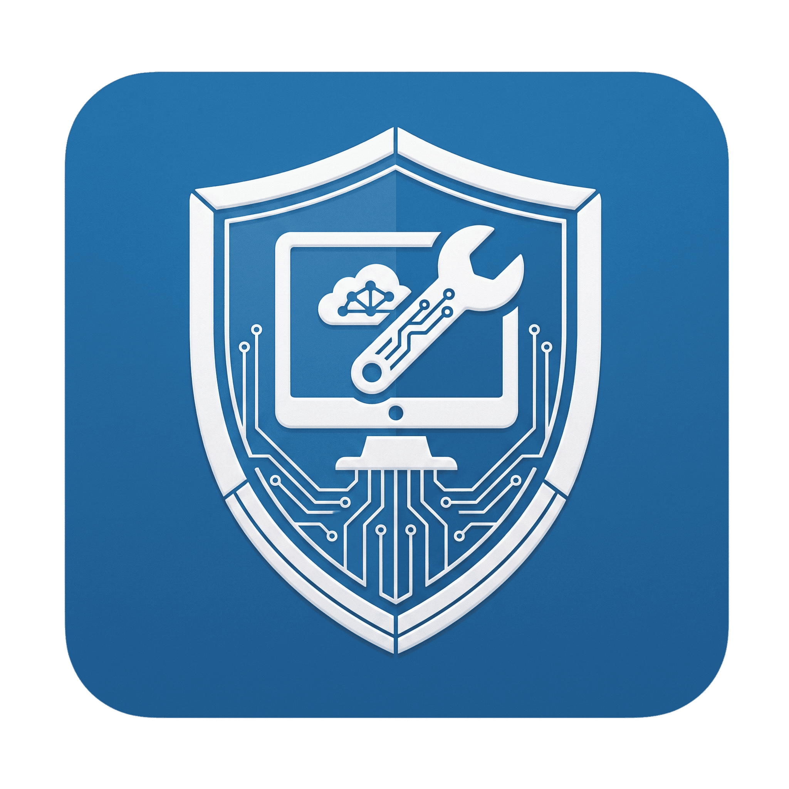
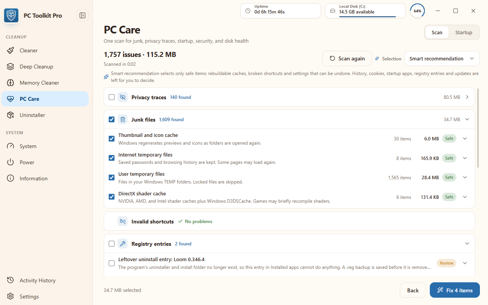
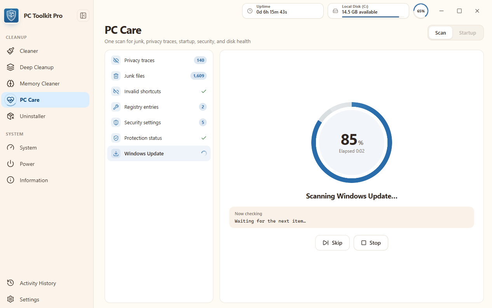
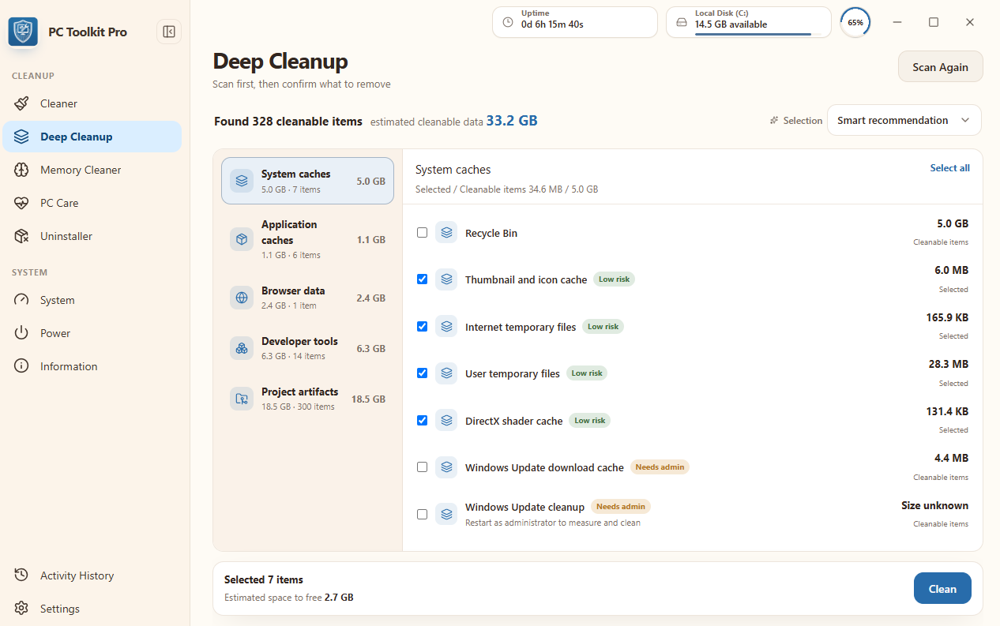
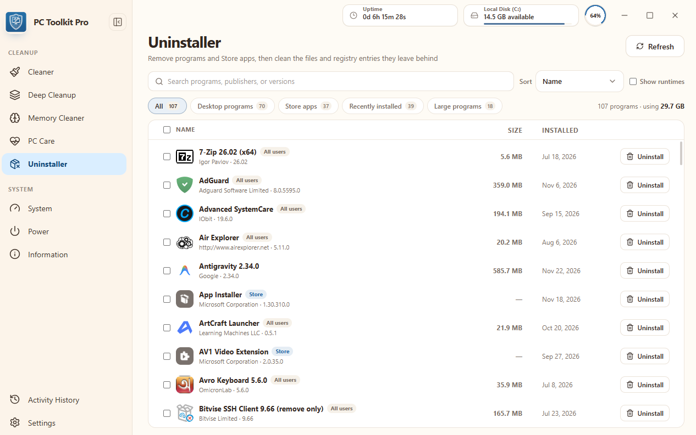
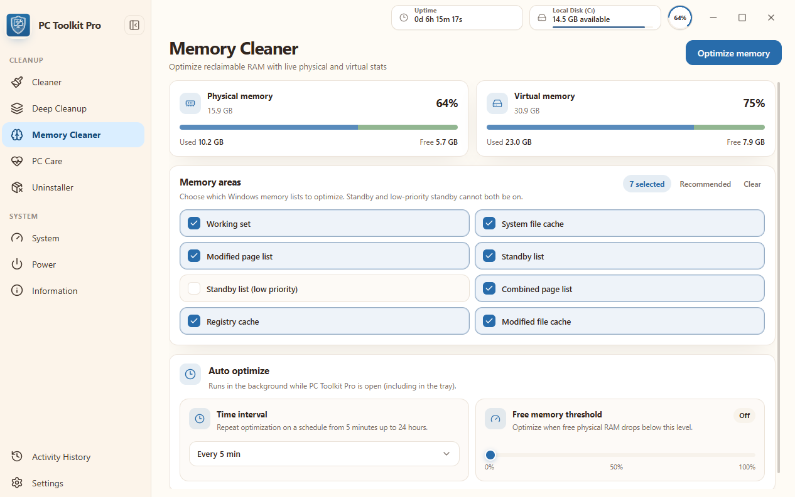
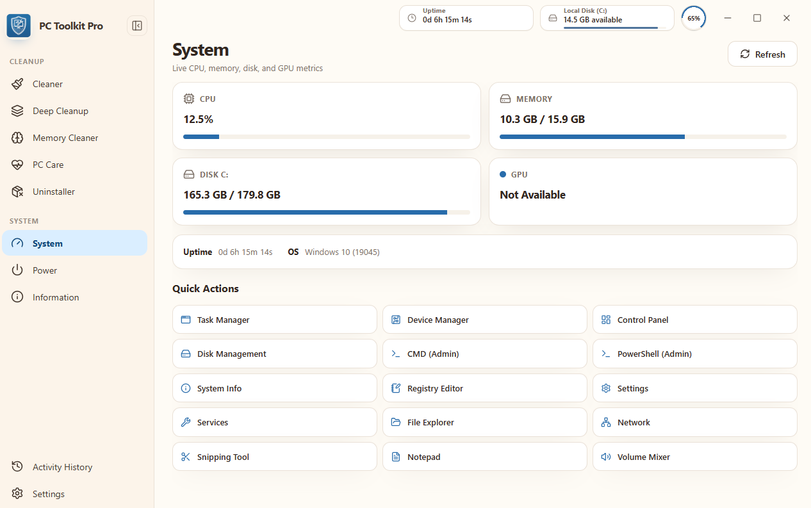

# PC Toolkit Pro

**Windows PC cleaner · PC care scan · app uninstaller · RAM / memory optimizer · startup manager · system monitor · power tools**

<p align="center">
  
</p>

**Free Windows system utility** to run a one-click PC care scan, uninstall apps with their leftovers, clean junk and developer caches, free RAM, manage startup apps, monitor CPU/disk/GPU, and control power options — from a soft modern desktop app + system tray.


**[Download PC Toolkit Pro for Windows](https://github.com/SSujitX/pc-toolkit-pro/releases/latest)** · [Features](#features) · [Develop](#develop) · [Build](#build)

---


## Why PC Toolkit Pro?

**PC Toolkit Pro** is a lightweight **Windows PC cleaner** and **system manager** for everyday maintenance: remove temp/junk files, **optimize memory / free RAM**, watch live resource usage, run quick Windows tools, schedule shutdown, and keep a full hardware report ready to copy.

Rebuilt from the ground up with **Tauri 2 + Vue 3 + Rust** for a fast, native-feeling desktop app — soft dense UI, hide-to-tray, signed auto-updates, and no heavy Electron runtime.

> **Inspiration (patterns only):** dense desktop cleanup chrome akin to [MangoDisk](https://github.com/harry0703/MangoDisk), plus Windows memory-clean workflows akin to [Win Memory Cleaner](https://github.com/IgorMundstein/WinMemoryCleaner) — original PC Toolkit Pro code, branding, and MIT license.

---


## Screenshots













---


## Features


| Area                               | What you get                                                                                                                                                           |
| ---------------------------------- | ---------------------------------------------------------------------------------------------------------------------------------------------------------------------- |
| **Junk / disk cleaner**            | Scan → confirm → clean temp, prefetch, recycle, and related junk with progress + cancel. Default scan works without admin (skip-and-continue on denied paths).         |
| **Deep Cleanup**                   | ~90 rule-based cache targets (system, apps, browsers, developer tools), project build output (`node_modules`, `target`, `bin/obj`, Unity/Unreal…, active projects protected), Windows Disk Cleanup handlers, Docker build cache, Conda, unused Rust toolchains, and local AI models. Smart recommendation, exact sizes, per-rule results; links, junctions and OneDrive placeholders are never followed. |
| **PC Care**                        | One fast parallel scan (seconds, not minutes) over privacy traces, junk, broken shortcuts, registry leftovers, startup items, security hardening, antivirus / firewall status, Windows Update, outdated apps (winget), disk health and drive optimization. Smart recommendation picks only safe items; per-item details; settings and registry fixes can be undone. |
| **Startup manager**                | Run keys, Startup folders, logon tasks and services: enable / disable like Task Manager, delayed start, boot impact from Windows' own boot log, "new item" flags. |
| **Uninstaller**                    | All desktop programs and Store apps with real icons; runs the app's own uninstaller (with "the uninstaller needs you" guidance), then scans and removes leftovers — files to the Recycle Bin, registry backed up as `.reg` first. Detects apps removed by other uninstallers. |
| **Memory cleaner / RAM optimizer** | Selectable memory areas, live physical & virtual RAM stats, auto-clean (from 5 minutes + free-RAM threshold) scheduled in the background — keeps working while the app sits in the tray. Click the titlebar RAM circle to optimize. Real Win32 APIs — honest skip when elevation is missing. |
| **System monitor**                 | Live CPU, RAM, disk, and NVIDIA GPU metrics in-app and in the titlebar.                                                                                                |
| **System tray**                    | Hide-to-tray, live RAM tooltip, Clean Memory, power shortcuts — same settings as the Memory page.                                                                      |
| **Power tools**                    | Shutdown, restart, sleep, lock, and scheduled shutdown.                                                                                                                |
| **Quick Actions**                  | One-click launch of common Windows tools and admin shells.                                                                                                             |
| **System information**             | Full hardware report (CPU, disks, RAM, GPU, monitors, motherboard, OS, PSU when available) with clipboard export.                                                      |
| **Activity history**               | Local history of every operation, with a configurable limit (keep the last 10, 20, … or a custom number).                                                              |
| **Settings & updates**             | Theme (light / dark / system), Start with Windows, start minimized to tray, always run as administrator, About dialog, and signed in-app updates from GitHub Releases. |


**Keywords this project targets:** Windows cleaner, PC cleaner, PC care, app uninstaller, leftover cleaner, startup manager, node_modules cleaner, junk file cleaner, temp file cleaner, disk cleanup, RAM cleaner, memory cleaner, free RAM, memory optimizer, Windows optimizer, system utility, system tray cleaner, Tauri Windows app, Vue desktop app.

---


## Stack

- **Shell:** Tauri 2 (window starts hidden until Vue mounts — no startup hang)
- **UI:** Vue 3 + TypeScript + Pinia + Tailwind CSS 4 + soft dense **PC Toolkit Pro** chrome
- **Backend:** `pctoolkit-core` (product logic, no Tauri) + `pctoolkit-platform` (Windows OS facts / Win32)
- **Updates:** `@tauri-apps/plugin-updater` + signed NSIS artifacts on GitHub Releases

---


## Download

1. Open **[Releases](https://github.com/SSujitX/pc-toolkit-pro/releases/latest)**
2. Run the **NSIS setup** (`PC Toolkit Pro vX.Y.Z Setup.exe`) — installs for the current user to `%LOCALAPPDATA%\PC Toolkit Pro\` (Start Menu + `uninstall.exe`, no admin required for install)
3. Optional: **Settings → Startup & administrator** — start with Windows (minimized to tray) and **Always run as administrator** for full memory clean, admin-only PC Care fixes and machine-wide uninstalls. Without it, admin-only items are skipped honestly and you can **Restart as administrator** when needed.
4. Optional: keep the app in the tray for quick **Clean Memory**, auto RAM cleanup and power actions

---


## Develop

```bash
pnpm install
pnpm tauri:dev
```

Needs **Rust stable** and **Windows C++ / MSVC** build tools.

UI-only preview (no Rust link):

```bash
pnpm dev
```

---


## Build

```bash
pnpm tauri:build
```

---


## License

[MIT](LICENSE) © PC Toolkit Pro / [SSujitX](https://github.com/SSujitX)

---

PC Toolkit Pro — Windows junk cleaner, RAM memory optimizer, system monitor, and power toolkit. Built with Tauri, Vue, and Rust.

---


### **Get Help**

- 🐛 **Issues**: [GitHub Issues](https://github.com/SSujitX/pc-toolkit-pro/issues)
- 💬 **Discussions**: [GitHub Discussions](https://github.com/SSujitX/pc-toolkit-pro/discussions)


### **Stay Updated**

- ⭐ **Star** this repository for updates
- 👀 **Watch** for new releases
- 🔔 **Follow** for announcements

---

**Made with ❤️ for the Windows Community**

*PC Toolkit Pro - Empowering Windows Users Since 2025*

[⬆️ Back to Top](#pc-toolkit-pro)